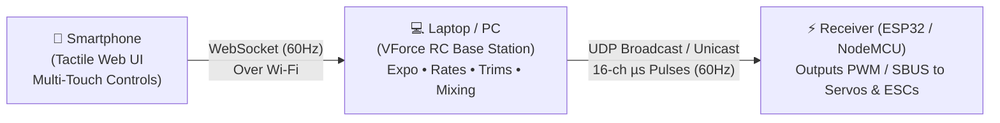

# VForce RC — General-Purpose RC Transmitter & Base Station

<p align="center">
  <strong>Transform your laptop and smartphone into an advanced, programmable 16-channel RC Transmitter Base Station.</strong><br/>
  High-powered channel processing on your PC, tactile multi-touch control on your phone, and live output to your hardware receiver over Wi-Fi UDP (ESP32 / NodeMCU).
</p>

<p align="center">
  
  
  
  
  
</p>

---

## 💡 Concept & Architecture

Commercial RC transmitters (like RadioMaster, FrSky, FlySky) have limited embedded compute and display hardware. **VForce RC** offloads the processing engine to your PC/laptop, using the compute power for exponential curves, dual rates, sub-trims, programmable mixing, and live multi-channel telemetry.



1. **Smartphone (Mobile Surface)**: The pilot's remote control interface. Fullscreen tactile clay controls (square-bounded gimbals with throttle hold, linear sliders, 2-pos / 3-pos toggle switches, momentary push buttons, rotary dials) with 60 Hz multi-touch streaming.
2. **PC / Base Station**: Runs the channel processing engine (`rc_controller.py`), applies trims, expo curves, rates, mixing rules, and clamps endpoints before broadcasting live telemetry to the dashboard monitor.
3. **Hardware Receiver (ESP32 / Microcontroller)**: Listens for binary UDP packets from the base station and outputs PWM pulses (1000 µs – 2000 µs) directly to servos, motor ESCs, or flight controllers.

---

## ✨ Features

- 🕹️ **16 RC Channels (CH1–CH16)**: Full standard servo timing range (`1000 µs` min • `1500 µs` center • `2000 µs` max).
- 🔲 **Square-Bounded Gimbal Travel**: Independent travel boundaries on X and Y axes. Setting throttle to 100% never restricts or compromises rudder deflection!
- ⚡ **Throttle Hold Mode**: Configure gimbals to hold position on finger release (like a physical throttle stick) or spring-return to center.
- 📈 **Interactive Exponential Curves & Dual Rates**: Real-time 2D curve preview graph with customizable exponential softening (0–100%) and rate travel scaling (10–140%).
- 🔀 **Programmable Channel Mixer**: Custom source-to-destination channel mixing with custom weights and offsets. Includes one-click presets for:
  - **Elevon / Delta Wing** (Flying wings)
  - **V-Tail**
  - **Differential Steering** (Dual-motor tanks / skid-steer rovers)
- 📊 **Live 16-Channel Telemetry Monitor**: Real-time bi-directional bar gauges showing live deflection, percentage, and exact servo pulse microseconds.
- 🎨 **Tactile Claymorphic Design**: Clean, minimalistic design with rounded corners, soft clay depth, zero glassmorphism, and no visual clutter.
- 📡 **Hardware Receiver Output**: Built-in UDP transmitter streaming 16-channel binary packets (`16 x uint16`, 32 bytes) or JSON directly to an ESP32 or NodeMCU receiver over Wi-Fi.
- 🔒 **Auto-Generated SSL**: Automatic self-signed SSL certificate generation for secure HTTPS access across your local network.
- 🛡️ **Failsafe System**: Automatic failsafe channel defaults applied when the phone disconnects or loses signal.

---

## 🚀 Getting Started

### 1. Clone the repository

```bash
git clone https://github.com/Agustasvj/VFORCETXRX.git
cd VFORCETXRX
```

### 2. Set up virtual environment & dependencies

**Linux:**
```bash
python3 -m venv venv_linux
source venv_linux/bin/activate
pip install -r requirements.txt
```

**Windows:**
```cmd
python -m venv venv
venv\Scripts\activate
pip install -r requirements.txt
```

### 3. Launch VForce Base Station

Use the launcher script:
```bash
./run.sh
```
*(or run `python3 main.py` within your active virtual environment)*

The base station will output your connection links:
```text
==============================================================
  VFORCE RC TRANSMITTER — BASE STATION RUNNING
==============================================================
  PC Dashboard : http://localhost:8000/
  Phone Link   : https://192.168.x.x:8443/mobile
  Ready for RC control, channel mixing & monitoring.
==============================================================
```

---

## 📱 Connecting Your Phone

1. Ensure your **PC and smartphone are connected to the same Wi-Fi network**.
2. On your phone, open your browser and navigate to the link shown in your terminal or dashboard:
   ```text
   https://<YOUR_PC_IP>:8443/mobile
   ```
3. **Accept the SSL certificate prompt**: Because modern browser touch and sensor APIs require a secure context, HTTPS is enabled using a self-signed certificate. Tap **"Advanced"** → **"Proceed to website"** once.
4. Rotate your phone to **Landscape mode** and tap **"ARM & TAKE CONTROL"** to enter the transmitter surface.

---

## 🖥️ PC Dashboard Overview (`http://localhost:8000`)

| Tab | Capabilities |
|---|---|
| **Layout & Map** | Visual drag-and-drop phone screen builder. Add sticks, sliders, switches, buttons, and knobs. Edit sizes, labels, and channel assignments. |
| **Live Channels** | Real-time 16-channel telemetry bar monitor with percentages and servo microseconds (`µs`). |
| **Trims & Expo** | Per-channel sub-trim (-50% to +50%), dual rates (10% to 140%), and exponential softening with an interactive 2D curve preview. |
| **Mixing & Limits** | Programmable multi-channel mixer with presets (Elevon, V-Tail, Diff Drive) + channel endpoint travel limits and failsafe values. |
| **Receiver / Link** | Phone connection link display + hardware UDP receiver target configuration (Target IP, Port, and Protocol). |

---

## 🔌 Hardware Receiver Integration (ESP32 / NodeMCU)

VForce streams 16-channel microsecond pulses over UDP at 60 Hz. You can receive this with an ESP32 or NodeMCU in Access Point (AP) or Station (STA) mode.

### Binary UDP Packet Structure (`udp_raw_us`)
The default binary protocol sends **32 bytes** per frame:
- 16 unsigned 16-bit big-endian integers (`uint16_t[16]`).
- Each integer represents the servo pulse width in microseconds (`1000` to `2000`).

```c
// Example ESP32 Arduino snippet:
#include <WiFi.h>
#include <WiFiUdp.h>

WiFiUDP udp;
const int UDP_PORT = 8888;
uint16_t channels[16];

void setup() {
  Serial.begin(115200);
  WiFi.softAP("VForce-RX", "12345678");
  udp.begin(UDP_PORT);
}

void loop() {
  int packetSize = udp.parsePacket();
  if (packetSize >= 32) {
    uint8_t buf[32];
    udp.read(buf, 32);
    for (int i = 0; i < 16; i++) {
      channels[i] = (buf[i * 2] << 8) | buf[i * 2 + 1];
    }
    // Write channels to PWM pins (ledcWrite / Servo library)
    // channels[0] = CH1 (Roll / Steer)
    // channels[2] = CH3 (Throttle)
  }
}
```

---

## 🗂️ Project Structure

```text
VFORCETXRX/
├── main.py                  # FastAPI base station server + WebSocket engine
├── rc_controller.py         # 16-channel RC processing engine (Expo, Rates, Mixing)
├── models.json              # Saved RC model configurations & channel maps
├── run.sh                   # Fast virtualenv launcher script
├── static/                  # Web UI
│   ├── index.html           # Root redirect to PC dashboard
│   ├── pc.html              # PC Base Station Dashboard
│   ├── pc.css               # Claymorphic desktop stylesheet
│   ├── pc.js                # Layout designer, live telemetry & curves visualizer
│   ├── mobile.html          # Mobile transmitter interface
│   ├── style.css            # Tactile mobile claymorphic controls
│   └── app.js               # Multi-touch input engine & 60Hz streaming
├── requirements.txt         # Project dependencies
└── README.md                # Documentation
```

---

## 📄 License

MIT License — free to use, modify, and build upon.
